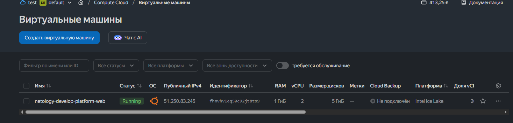
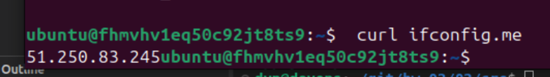
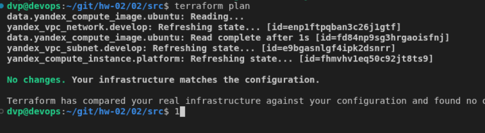
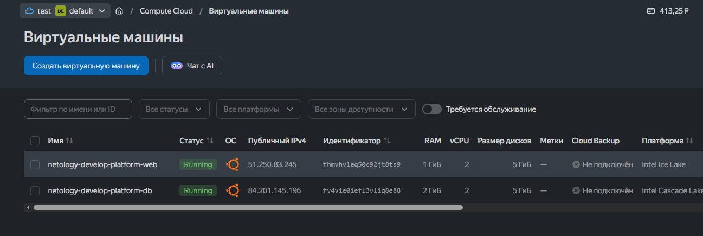

# Домашнее задание к занятию "`Основы Terraform. Yandex Cloud`" - `Прокутин ДВ`

---

### Задание 1

В качестве решения приложите:

скриншот ЛК Yandex Cloud с созданной ВМ, где видно внешний ip-адрес;
скриншот консоли, curl должен отобразить тот же внешний ip-адрес;
ответы на вопросы.

1. Инициализируйте проект, выполните код. Исправьте намеренно допущенные синтаксические ошибки. Ищите внимательно, посимвольно. Ответьте, в чём заключается их суть.
    - исправлена опечатка   platform_id = "standard-v3"
    v4 отсутвует
    - cores         = 2 минимальное 
    - исправлено core_fraction = 20 показатель гарантированного времени cpu 

6. Ответьте, как в процессе обучения могут пригодиться параметры preemptible = true и core_fraction=5 в параметрах ВМ.
    - preemptible = true  прерываемая vm  останавляваеться до 24х часов , позовляет экономить деньги 
    - core_fraction = 5 процент гарантированного процессорного времени, тоже позволяет экономить деньги




---

### Задание 2

Замените все хардкод-значения для ресурсов yandex_compute_image и yandex_compute_instance на отдельные переменные. К названиям переменных ВМ добавьте в начало префикс vm_web_ . Пример: vm_web_name.
Объявите нужные переменные в файле variables.tf, обязательно указывайте тип переменной. Заполните их default прежними значениями из main.tf.
Проверьте terraform plan. Изменений быть не должно.
Задание 3




---

### Задание 3

Создайте в корне проекта файл 'vms_platform.tf' . Перенесите в него все переменные первой ВМ.
Скопируйте блок ресурса и создайте с его помощью вторую ВМ в файле main.tf: "netology-develop-platform-db" , cores  = 2, memory = 2, core_fraction = 20. Объявите её переменные с префиксом vm_db_ в том же файле ('vms_platform.tf'). ВМ должна работать в зоне "ru-central1-b"
Примените изменения.
    - with yandex_compute_instance.db,
│   on main.tf line 50, in resource "yandex_compute_instance" "db":
│   50: resource "yandex_compute_instance" "db" 




### Задание 4

`Приведите ответ в свободной форме........`

1. `Заполните здесь этапы выполнения, если требуется ....`
2. `Заполните здесь этапы выполнения, если требуется ....`
3. `Заполните здесь этапы выполнения, если требуется ....`
4. `Заполните здесь этапы выполнения, если требуется ....`
5. `Заполните здесь этапы выполнения, если требуется ....`
6. 

```
Поле для вставки кода...
....
....
....
....
```

`При необходимости прикрепитe сюда скриншоты
`
